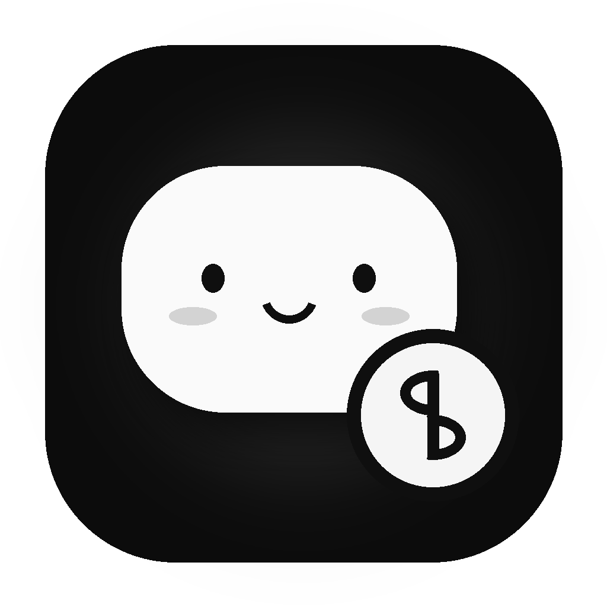
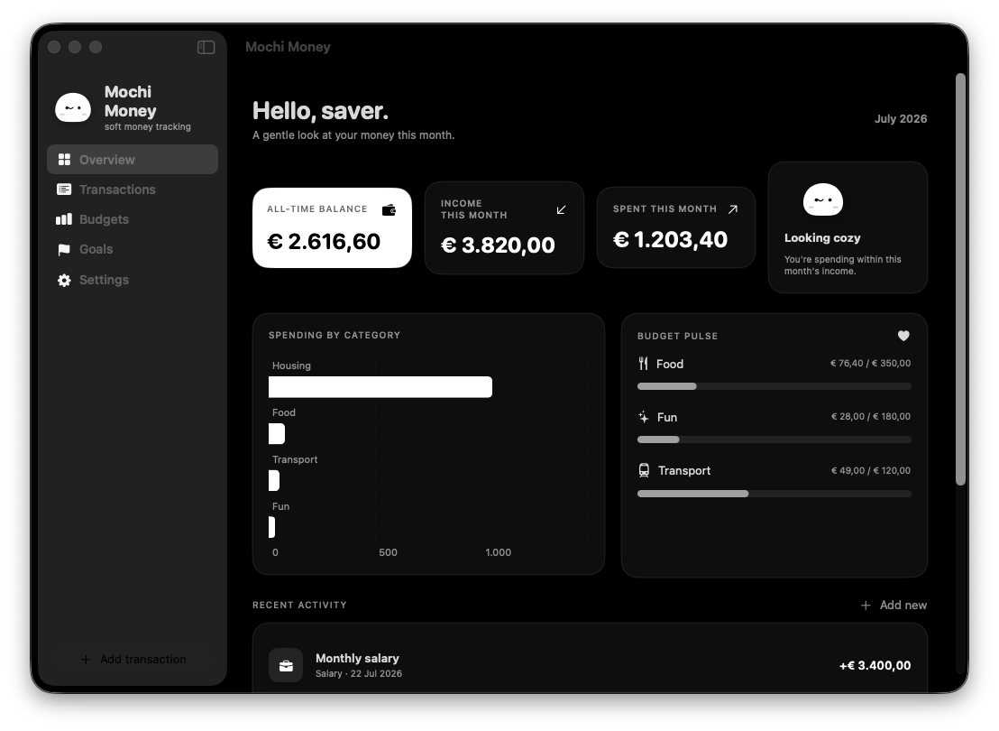
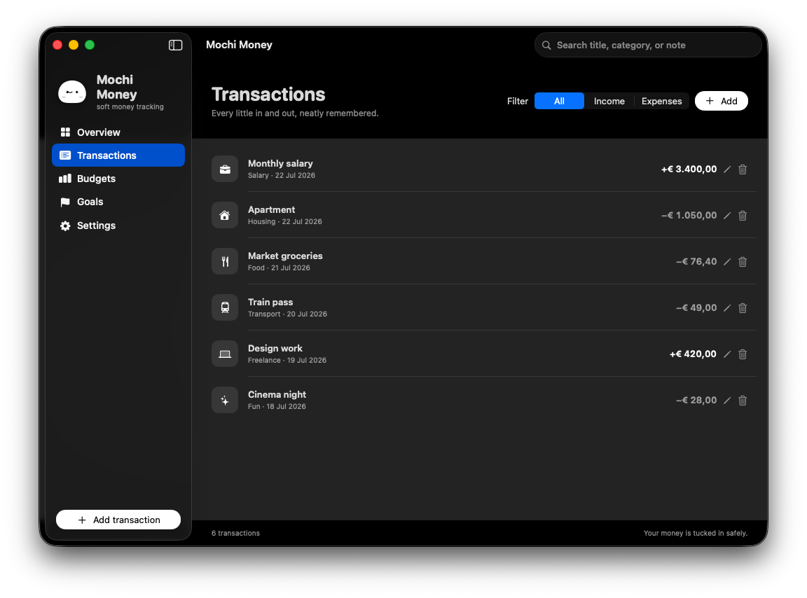
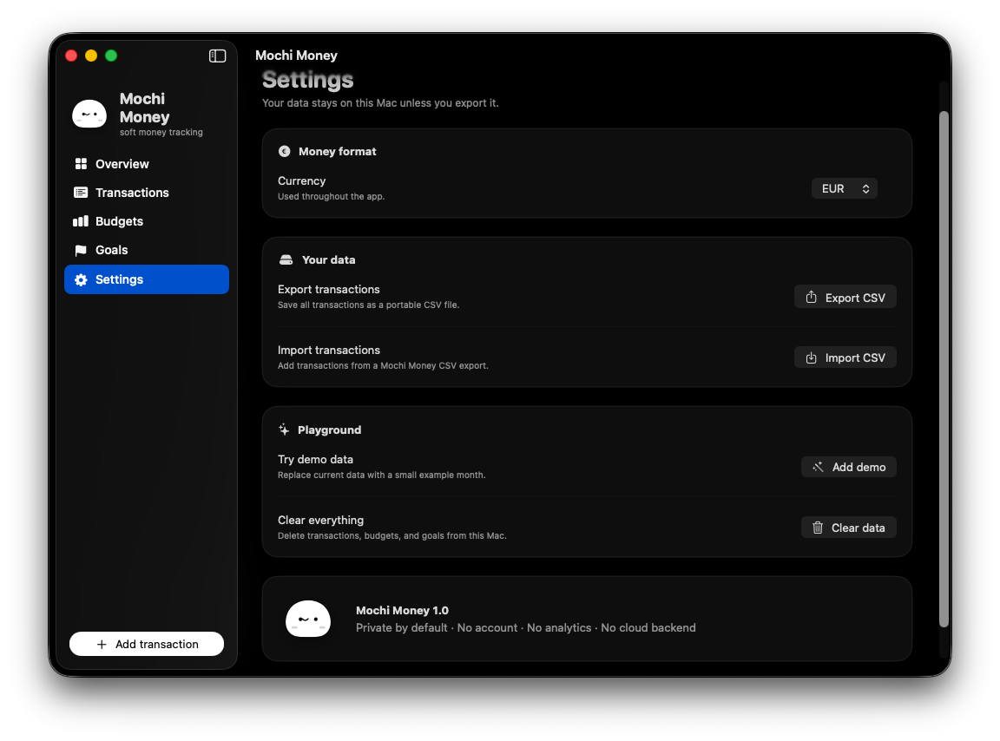

# Mochi Money

<p align="center">
  
</p>

<p align="center">
  A private, native macOS money tracker with an adorable monochrome interface.<br>
  No account. No analytics. No cloud backend.
</p>

<p align="center">
  <a href="https://github.com/wuser-lab/mochi-money/releases/latest"><strong>Download the latest DMG</strong></a>
</p>



## Included

- Dashboard with all-time balance, monthly income and spending, category chart, and recent activity.
- Income and expense transactions with categories, notes, dates, search, filters, editing, and deletion.
- Monthly category budgets with live progress and remaining amounts.
- Savings goals with targets, progress, and optional dates.
- Currency selection for EUR, USD, GBP, CHF, JPY, CAD, AUD, and PLN.
- CSV import and export.
- Local JSON persistence in Application Support.
- Optional demo data.

## Screenshots

### Transactions

Search, filter, edit, and remove income or expenses without leaving the list.



### Settings and portability

Change currency, import or export CSV data, load a demo, or clear local records.



## Privacy

There is no account, analytics, advertising, or cloud backend. Data stays in `~/Library/Application Support/MochiMoney/money.json` unless you export it.

## Install

1. Download `Mochi-Money.dmg` from the [latest release](https://github.com/wuser-lab/mochi-money/releases/latest).
2. Open the DMG.
3. Drag **Mochi Money** into **Applications**.

The universal build supports Apple Silicon and Intel Macs running macOS 14 or later.

The release is ad-hoc signed. Public distribution without a Gatekeeper warning requires an Apple Developer certificate and notarization.

## Build from source

Requirements: Xcode 16 or newer, macOS 14+, and Python with Pillow for icon generation.

```bash
python3 -m pip install Pillow
./build.sh ./dist
```

This compiles both `arm64` and `x86_64`, creates a universal application bundle, signs it ad-hoc, and produces `Mochi-Money.dmg`.

## Test

```bash
swiftc -swift-version 5 Sources/Models.swift Sources/CSVCodec.swift Tests/main.swift -o /tmp/mochi-money-tests
/tmp/mochi-money-tests
```
