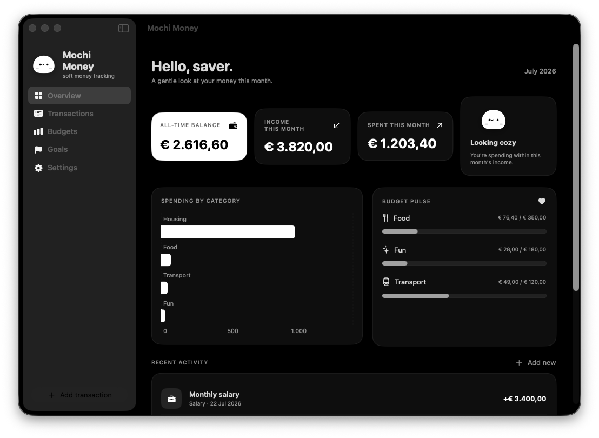
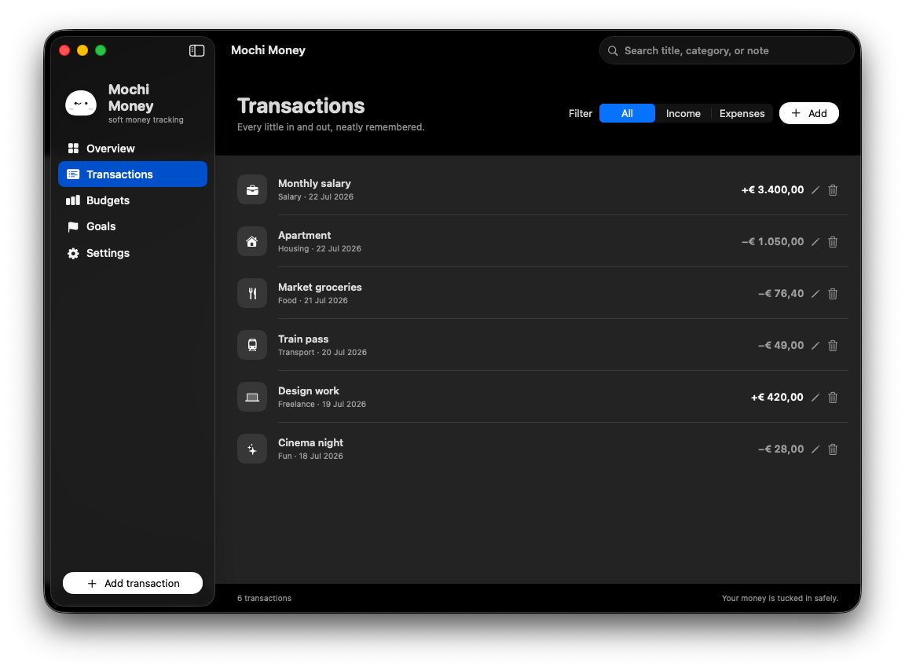
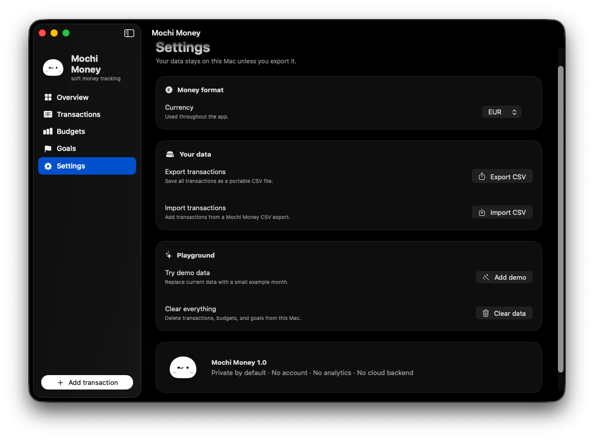

> **W Money iOS — current scope:** local budgeting, goals, CSV import/export and on-device planning. Online banking and worldwide rankings are paused and hidden in the default build. The latest local candidate is version 1.1.0, build 2; public release is on hold. See [release readiness](release/READINESS.md).

# W Money

<p align="center">
  
</p>

<p align="center">
  A calm, native money tracker for iPhone, with savings goals and a practical monthly plan.<br>
  No ads. No analytics. Local tracking works without an account.
</p>

<p align="center">
  <a href="https://github.com/wuser-lab/mochi-money/releases/latest"><strong>Download the latest DMG</strong></a>
</p>



## iPhone redesign

W Money has a focused overview, searchable and editable activity, savings goals with progress updates, adaptive light/dark appearance, a separate sample ledger and a new W icon. The iPhone release is being prepared for App Store review. The original macOS source and download remain below.

## Included

- Dashboard with all-time balance, monthly income and spending, category chart, and recent activity.
- Income and expense transactions with categories, notes, dates, search, filters, editing, and deletion.
- Monthly category budgets with live progress and remaining amounts.
- Savings goals with targets, progress, and optional dates.
- Currency selection for EUR, USD, GBP, CHF, JPY, CAD, AUD, and PLN.
- CSV import and export.
- Local JSON persistence in Application Support.
- Optional demo data.

## Screenshots

### Transactions

Search, filter, edit, and remove income or expenses without leaving the list.



### Settings and portability

Change currency, import or export CSV data, load a demo, or clear local records.



## Privacy

There is no Mochi account, analytics, or advertising. Your ledger stays in `~/Library/Application Support/MochiMoney/money.json`. Optional bank sync shares authorized bank data through Enable Banking and your private connection service.

## Install

1. Download `Mochi-Money.dmg` from the [latest release](https://github.com/wuser-lab/mochi-money/releases/latest).
2. Open the DMG.
3. Drag **Mochi Money** into **Applications**.

The universal build supports Apple Silicon and Intel Macs running macOS 14 or later.

The release is ad-hoc signed. Public distribution without a Gatekeeper warning requires an Apple Developer certificate and notarization.

## Build from source

Requirements: Xcode 16 or newer, macOS 14+, and Python with Pillow for icon generation.

```bash
python3 -m pip install Pillow
./build.sh ./dist
```

This compiles both `arm64` and `x86_64`, creates a universal application bundle, signs it ad-hoc, and produces `Mochi-Money.dmg`.

## Test

```bash
swiftc -swift-version 5 Sources/Models.swift Sources/CSVCodec.swift Tests/main.swift -o /tmp/mochi-money-tests
/tmp/mochi-money-tests
```

### Imported categories and own-account transfers

KBC and Revolut statement imports use merchant names in titles and notes to suggest
categories when the category is empty or Other. Existing explicit categories are
preserved, and unrecognized merchants stay Other. Scholarship receipts have their
own income category.

For these statement imports, account-holder names and masked debit-card suffixes
in KBC notes identify own-account payments and Revolut top-ups. Transfers are kept
in the ledger, hidden from the default transaction list and recent activity, and
excluded from income, spending, category charts, and budgets. Their original cash
entries still contribute to the all-time balance, including transfers whose other
side falls outside the statement period. Use Show transfers to review them, or
edit a transaction's Transfer between my accounts checkbox to correct detection.
Existing imports are classified when the app opens; no re-import is needed.

Additional statement rules distinguish cash withdrawals, investments, health
insurance, university fees, and confirmed campus accommodation payments. The
spending chart shows every category and its amount instead of only six bars.


### Optional automatic bank imports

Settings now includes Bank connections for a private Enable Banking service.
See [bank sync setup](BankSyncService/README.md) for provider registration,
local/HTTPS service configuration, consent, and limitations. This feature is
optional: file imports and the local ledger still work without a service.
Automatic checks run about every six hours while the app is open. Live bank
access requires your provider account to be activated and your bank consent;
it is not enabled by installing Mochi Money alone.

## Money-flow coach and iPhone app (development)

The **Money flow** tab analyzes the last three complete calendar months, excludes own-account transfers and foreign-currency entries, and allocates historical surplus across goals in deadline order. Adjust the monthly cushion before using the suggestions. Unknown currencies are assumed to match the ledger. This is a historical budgeting estimate, not a verified balance or automated transfer instruction.

The optional **Explain my plan** button uses Apple's on-device Foundation Models on supported Apple Intelligence devices with OS 26+. The planner works without AI. No remote AI service is configured. Generated text is experimental and may be incorrect.

The native iPhone MVP source is in `iOS/`, with an XcodeGen specification in `project.yml`. It shares the desktop transaction format and planner, supports local entry, CSV import/export, goals and local deletion. The iPhone now offers in-app Apple registration and a Connect your bank flow, with per-account bank access and local ledgers. It requires deployment and provider activation of the new account backend; users do not configure service URLs or keys. Ledger edits and goals do not automatically sync between devices. See [in-app accounts and production activation](docs/APP-ACCOUNTS.md).

To build with full Xcode and an iOS SDK installed:

```sh
brew install xcodegen
xcodegen generate
open MochiMoney.xcodeproj
```

Select your development team and a unique bundle identifier, then run on a simulator and a physical iPhone. AI requires a supported physical device. A signed archive, App Store Connect configuration, production support/privacy URLs, icon/screenshots and TestFlight validation are required before submission. See `docs/PRODUCT-PLAN.md` for roadmap and release gates. This development version has not been submitted to Apple.

Planner verification:

```sh
swiftc -swift-version 5 Sources/Models.swift Sources/FlowPlanner.swift Tests/Planner/main.swift -o /tmp/mochi-planner-tests
/tmp/mochi-planner-tests
```

### Optional worldwide progress

The iPhone Worldwide tab compares monthly improvements in savings rate after starting a Mochi plan. Tracking is private by default. A separate opt-in can share a generated nickname, optional country and percentage-point improvement; transaction details and exact amounts stay private. Users can withdraw sharing or delete tracking. The chart needs the hosted account service and completed bank history; it does not claim that AI caused the observed change. See [comparison method and privacy](docs/WORLDWIDE-PROGRESS.md).
